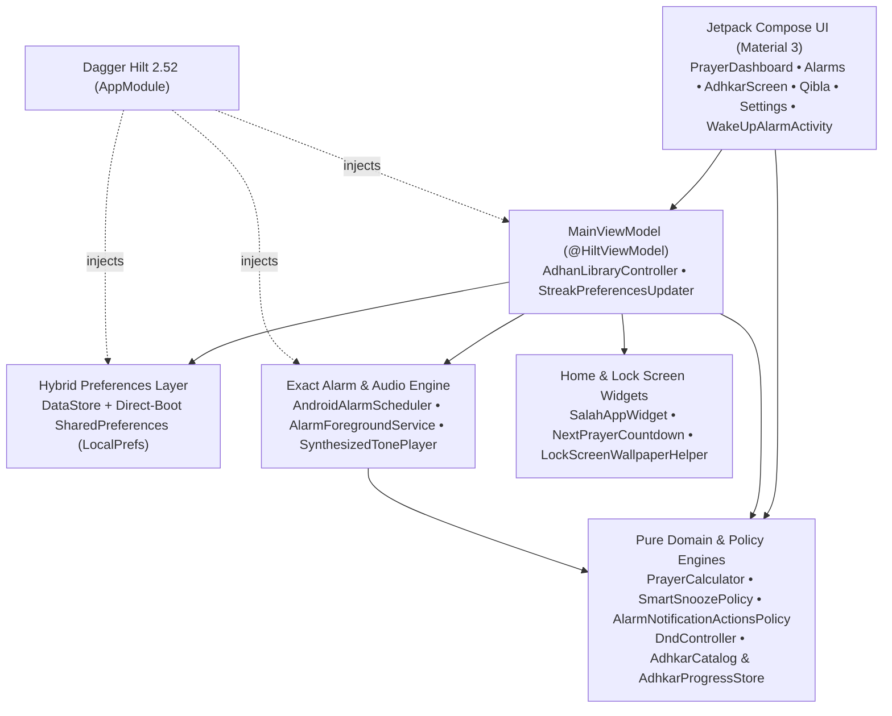

<div align="center">


# Mo Alarm • منبّه الصلاة والفجر

**Sanctuary-Grade Islamic Prayer Times, Un-Bypassable Fajr Wake-Up Challenges, Interactive Adhkar & Tasbih, 292 Adhan Voices, Independent Jumu'ah Smart DND & Transparent Home/Lock Screen Widgets (Android & iOS)**


<br/><br/>

[**🌐 Official Landing Page (صفحة التحميل الرسمية)**](https://mohamedredaaa.github.io/mo-alarm/) • [**⬇️ Download Android APK (`v1.4.3` — `app-release.apk`)**](https://github.com/Mohamedredaaa/mo-alarm/releases/download/v1.4.3/app-release.apk) • [**🍎 Download iPhone IPA (`v1.4.3` — `MoAlarm-iOS-v1.4.3.ipa`)**](https://github.com/Mohamedredaaa/mo-alarm/releases/download/v1.4.3/MoAlarm-iOS-v1.4.3.ipa) • [**📦 View All GitHub Releases**](https://github.com/Mohamedredaaa/mo-alarm/releases/tag/v1.4.3)

<br/>


</div>

---

## App Design & Sanctuary UI System • تصميم التطبيق والواجهات

Mo Alarm is crafted around an **OLED-first Sanctuary Obsidian & Champagne Gold** design language (`#0A0E0D` Obsidian Canvas, `#121816` Submerged Surface, `#E5C158` Champagne Gold, and `#2DD4BF` Sacred Emerald) engineered for zero eye strain at Fajr and Tahajjud across five dedicated tabs: **Prayers (`المواقيت`)**, **Alarms (`التنبيهات`)**, **Adhkar (`الأذكار`)**, **Qibla (`القبلة`)**, and **Settings (`الإعدادات`)**.

<div align="center">
  <br/>
  <sub><b>Left:</b> One-tap transparent Lock Screen prayer grid under the clock • <b>Center:</b> Per-prayer Adhan voices, Iqamah chime chips & Wear OS actions • <b>Right:</b> Sanctuary OLED color tokens</sub>
</div>

### Compact 2×1 Transparent Home Screen Widget (Fits Between App Icons)

<div align="center">
  <br/>
  <sub><b>2×1 Transparent Prayer Times Grid (`فجر / ظهر / مغرب | تهجد / عصر / عشاء`)</b> — displays every prayer time cleanly, highlights the upcoming prayer automatically, and works 100% side-by-side with banking apps like <b>InstaPay</b>.</sub>
</div>

### Detailed Live Screen Captures • لقطات حية من داخل التطبيق

<div align="center">
<table>
  <tr>
    <td align="center" width="25%">
      <br/>
      <sub><b>1. Prayer Schedule, Sunrise & Streak</b><br/>مواقيت الصلاة والشروق وسلسلة الفجر</sub>
    </td>
    <td align="center" width="25%">
      <br/>
      <sub><b>2. Alarms, Jumu'ah & Mosque Silent</b><br/>التنبيهات ووضع الجمعة وصامت المسجد</sub>
    </td>
    <td align="center" width="25%">
      <br/>
      <sub><b>3. Un-Bypassable Wake-Up Check</b><br/>تحدي الاستيقاظ غير القابل للتجاوز</sub>
    </td>
    <td align="center" width="25%">
      <br/>
      <sub><b>4. Sensor-Fused Qibla Compass</b><br/>بوصلة القبلة الدقيقة</sub>
    </td>
  </tr>
</table>
</div>

---

## Key Features • المميزات الرئيسية

### 1. Precision Prayer Dashboard, Sunrise (`الشروق`) & Streak • لوحة المواقيت والشروق وسلسلة المواظبة
- **100% On-Device Astronomical Engine + Built-In Egypt Winter/Summer Time (`التوقيت الشتوي والصيفي المصرى التلقائي`):** Calculates **Fajr, Sunrise (`الشروق`), Dhuhr, Asr, Maghrib, Isha**, and **Tahajjud (Last Third of the Night)** locally with zero internet dependency, and includes a deterministic **Egypt DST / Winter Time resolver (`CityTimeZoneResolver` — Law No. 24 of 2023: `UTC+2` Winter Time / `UTC+3` Summer Time)** so prayer times, widgets, and alarms update automatically even on Android phones with outdated OS timezone databases.
- **Chronological Sunrise (`الشروق`) Row:** Displayed directly beneath Fajr (`نهاية وقت الفجر • الضحى بعد ١٥ د` / `Fajr ends • Duha +15m`) so you always see when Fajr time ends and Duha begins.
- **Daily Check-In & 7-Day Fajr Streak Bar (`المداومة على الفجر`):** Integrated directly below the live Next-Prayer countdown card so you can check off daily prayers (`X/6`) and track your 7-day Fajr consistency in one place.
- **1-Tap Alert Mode Cycling:** Tap any prayer row's trailing bell/speaker icon to cycle instantly (`Wake-Up Alarm` → `Adhan Sound` → `Silent Notification` → `Muted`) with crisp haptic feedback, or tap the row to customize pre-reminders, sound profiles, and Iqamah delays.
- **Global Calculation Authorities & High-Latitude Rules:**
  - **Egyptian General Authority of Survey** (الهيئة المصرية العامة للمساحة)
  - **Umm al-Qura University, Makkah** (أم القرى — مكة المكرمة)
  - **Muslim World League — MWL** (رابطة العالم الإسلامي)
  - **ISNA — North America** (الجمعية الإسلامية لأمريكا الشمالية)
  - **University of Islamic Sciences, Karachi** (جامعة العلوم الإسلامية بكراتشي)
  - Standard (**Shafi'i / Maliki / Hanbali**) and **Hanafi** Asr ratios, **Middle of Night / One-Seventh / Angle-Based** high-latitude rules, per-prayer offsets (`-30` to `+30` min), and Hijri adjustment (`-2` to `+2` days).

### 2. Un-Bypassable Fajr & Tahajjud Wake-Up System • منظومة الاستيقاظ غير القابلة للتجاوز
- **Strict Wake-Up Challenge Enforcement:** When `Wake-Up Alarm` rings, direct `"Stop Sound"`, `"Mark Prayed"`, notification swipe-dismissal, in-app banner stop, hardware volume keys, and Back gestures are all locked out—both the notification `"Solve Challenge • حل التحدي"` action and the in-app ringing banner route exclusively to `WakeUpAlarmActivity`.
- **4 Dismissal Challenges:** Configurable **Math Equations (`معادلات حسابية`)**, **Phone Shake (`هزّ الهاتف`)**, **Dhikr Verification (`تحدي الذكر`)**, or **Slide to Wake (`سحب للاستيقاظ`)**.
- **Sunrise-Guarded Smart Snooze (`حارس الشروق`):** `"Snooze 5m • غفوة ٥ د"` is offered only when `SmartSnoozePolicy` confirms enough time remains before Sunrise and within the snooze cap (`maxSnoozes = 2`).
- **Post-Dismissal Fajr Awake Check (`تأكيد الاستيقاظ بعد الفجر`):** Optional follow-up verification check 5 minutes after solving the Fajr wake-up challenge (automatically skipped for advance `preremind_*` alerts and cancelled once Fajr is marked prayed).
- **Pre-Prayer Reminders & Gentle Rising Volume:** Optional `5–60` minute advance alerts before prayer, smooth volume ramp, and automatic audio silencing only during active incoming phone/VoIP calls.

### 3. Categorized Interactive Adhkar & Persistent Digital Tasbih • الأذكار التفاعلية والسبحة الإلكترونية
- **121 Complete Authentic Adhkar Across 6 Categories (Top of `الأذكار` Tab — Sourced from [IslamBook Azkar](https://www.islambook.com/azkar)):**
  - **Post-Salah (`أذكار بعد الصلاة` — 14 Adhkar)** • **Prayer Duas (`أذكار الصلاة` — 29 Adhkar from `islambook.com/azkar/22`)** • **Adhan & Mosque (`الأذان والمسجد` — 9 Adhkar)** • **Morning (`أذكار الصباح` — 23 Adhkar)** • **Evening (`أذكار المساء` — 23 Adhkar)** • **Sleep (`أذكار النوم` — 14 Adhkar)**
  - Includes full vocalized Arabic texts, authentic hadith virtues/references, and exact repetition counts (*Istiftah*, *Ruku'*, *I'tidal*, *Sujud*, *Jalsah between Prostrations*, *Tashahhud*, *Salat Ibrahimiyyah*, *Pre-Taslim Duas*, *Sujud al-Tilawah*, *Going to & Entering/Leaving the Mosque*, *Istighfar & Allahumma Antas-Salam*, *Ayat al-Kursi*, *Al-Mu'awwidhat*, *Sayyidul Istighfar*, *Khawatim Al-Baqarah* `2:285-286`, *Tasbih Fatimah* `33 / 33 / 34`, and all morning/evening/sleep supplications).
  - **Customizable Post-Adhan Going-to-Mosque Dua Reminder (`تذكير دعاء الذهاب إلى المسجد`):** Global toggle and delay selector (`2m / 3m / 5m / 7m / 10m / 15m` after every Adhan) on the **Alarms (`التنبيهات`)** screen that displays `"ما تنساش دعاء الذهاب إلى المسجد 🤲"` with the full vocalized Dua text directly on the Lock Screen (`BigTextStyle`) and one-tap shortcuts to Mosque & Prayer Duas.
  - **Tap-to-Count Daily Progress:** Tap any Dhikr card to increment its `current / target` badge (with milestone double-pulse vibration at `33`, `66`, `99`, and completion, turning Sacred Emerald with a checkmark when done), one-tap per-category reset, and automatic midnight rollover in your selected city's timezone.
- **Persistent Digital Tasbih (Bottom of `الأذكار` Tab):**
  - `0–100` Post-Salah counter (`33× SubhanAllah • 33× Alhamdulillah • 33× Allahu Akbar • 100th La ilaha illa Allah`) persisted in Direct-Boot `LocalPrefs` across tab switches and app restarts.
  - **Milestone Double-Pulse Vibration:** Emits a distinct dual-pulse `VibrationEffect` waveform at `33`, `66`, `99`, and `100`.

### 4. Per-Prayer Adhan Voices, 292 Online Catalog & Iqamah Chimes • أصوات الأذان وتنبيهات الإقامة
- **Bundled High-Clarity Voices:** Makkah Haram Adhan, Fajr Special Adhan, Sheikh Raad Al-Kurdi, Sheikh Sabah Fakhri, Gentle Chime, and Deep Sanctuary Bell.
- **292 Muezzin Online Library (`مكتبة الأذان`):** Browse, preview, and download **292 authentic Adhan recordings** across the Islamic world (with automatic Azure CDN fallback when `islamweb.net` is restricted). Downloaded Adhans play **100% offline**.
- **Custom Audio & Iqamah Reminder (`تنبيه الإقامة`):** Assign distinct audio per prayer plus optional gentle Iqamah chimes `5–45` minutes after Adhan.

### 5. Independent Jumu'ah Smart Mode, Mosque Auto-Silent & Qibla • وضع الجمعة وصامت المسجد والقبلة
- **Independent Jumu'ah Friday Smart Mode (`وضع صلاة الجمعة الذكي`):** Located on the **Alarms (`التنبيهات`)** screen; automatically activates extended Do Not Disturb (`20–90` min) at Friday Dhuhr **even if weekday Mosque Auto-Silent is turned off**, with automatic DND permission onboarding.
- **Mosque Auto-Silent (`الوضع الصامت التلقائي بالمسجد`):** Automatically enables Priority DND at daily prayer times and restores your previous ringer mode after `10–60` minutes.
- **Sanctuary Qibla Compass:** Real-time sensor-fused Qibla bearing (`°` from True North), turn-direction delta, alignment haptics, and great-circle distance (`km`) to Makkah.

### 6. Home Screen & Lock Screen Widgets • ويدجت الشاشة الرئيسية وشاشة القفل
- **2×1 Transparent 2×3 Prayer Grid Widget & Live `Chronometer` Countdown Widget** for the Android Home Screen.
- **InstaPay-Safe Lock Screen Notification Card** without any `AccessibilityService`.
- **Non-Destructive Transparent Lock Screen Table (`الجدول الشفاف فوق شاشة القفل`):** Composites the 2×3 prayer schedule onto your **existing** Lock Screen wallpaper—or onto a custom photo you pick from Gallery—without replacing your background with a predefined image, updating the highlighted prayer automatically at every prayer transition and restoring your original wallpaper cleanly when disabled.

### 7. Native iOS Companion App (`ios/`) • نسخة iOS الأصلية
- Includes a complete **Swift 5.10 / SwiftUI (iOS 17+)** target under [`ios/`](ios) featuring offline astronomical calculation, Qibla compass, wake-up challenges, `MoAlarmWidgets` (**WidgetKit** Home/Lock Screen widgets + **Dynamic Island Live Activity**), unit tests (`MoAlarmTests`), XcodeGen spec ([`ios/project.yml`](ios/project.yml)), and macOS GitHub Actions CI ([`ios/ci/ios-build.yml`](ios/ci/ios-build.yml)).

---

## Installation • طريقة التثبيت (للمستخدمين)

You can share and install the release APK directly on any Android phone (**Android 8.0 Oreo / API 26** up to **Android 15 / API 35**).

### Step 1: Install the APK • تثبيت ملف التطبيق
1. **Download directly from the Official Landing Page or GitHub Releases:**
   - [**🌐 Official Landing Page (`mohamedredaaa.github.io/mo-alarm`)**](https://mohamedredaaa.github.io/mo-alarm/)
   - [**⬇️ Direct Download: `app-release.apk` (`v1.4.3`)**](https://github.com/Mohamedredaaa/mo-alarm/releases/download/v1.4.3/app-release.apk)
   - Or from the [Releases page](https://github.com/Mohamedredaaa/mo-alarm/releases/tag/v1.4.3) (or locally at `app/build/outputs/apk/release/app-release.apk` when building from source).
2. Open `app-release.apk` on your phone to install.
3. If prompted by Android, allow **"Install unknown apps"** (`تثبيت التطبيقات غير المعروفة`) for your browser or file manager.

### Step 1B: Install on iPhone (iOS 17+ — Free `.ipa` via Sideloadly / AltStore / SideStore) • التثبيت على الأيفون مجاناً
1. **Download the iOS `.ipa` package (`MoAlarm-iOS-v1.4.3.ipa`):**
   - [**🍎 Direct Download: `MoAlarm-iOS-v1.4.3.ipa`**](https://github.com/Mohamedredaaa/mo-alarm/releases/download/v1.4.3/MoAlarm-iOS-v1.4.3.ipa) (compiled automatically by [`.github/workflows/ios-build.yml`](.github/workflows/ios-build.yml)).
2. **Sideload for Free using your Apple ID:**
   - Open [**Sideloadly**](https://sideloadly.io) (Windows / macOS) or [**AltStore / SideStore**](https://altstore.io), connect your iPhone, and drag `MoAlarm-iOS-v1.4.3.ipa` into the window using your free Apple ID.
3. **Trust on iPhone:**
   - On your iPhone, open `Settings → General → VPN & Device Management` (`الإعدادات ← عام ← VPN وإدارة الجهاز`), tap **Trust** (`الوثوق`) on your Apple ID certificate, and enable `Developer Mode` (`وضع المطور`) on iOS 17+.

### Step 2: Recommended First-Launch Permissions • الأذونات الموصى بها عند التشغيل الأول
When you open **Mo Alarm** for the first time, the built-in onboarding card guides you through:
1. **Notifications (`الإشعارات`):** Required on Android 13+ so prayer alerts and the Lock Screen card appear.
2. **Exact Alarms (`المنبّهات الدقيقة`):** Ensures Adhan and Fajr alarms fire at the exact second during Doze mode.
3. **Full-Screen Alarm Display (`الظهور بملء الشاشة على شاشة القفل`):** Required on **Android 14+** so the Fajr Wake-Up Challenge wakes the screen when locked.
4. **Do Not Disturb Access (`عدم الإزعاج`):** Prompted automatically when you enable **Mosque Auto-Silent** or **Jumu'ah Smart Mode**.

### Step 3: Prevent Battery Optimization from Stopping Alarms (Xiaomi / Samsung / Honor / Huawei / Oppo)
Some phone manufacturers aggressively kill background alarm apps unless set to **Unrestricted**:
- Open **Mo Alarm** → **Settings (`الإعدادات`)** → tap **OEM Battery Guide (`ضمان عمل المنبّه في الخلفية`)**, or go to:
  - **Samsung:** `Settings → Apps → Mo Alarm → Battery → Unrestricted`
  - **Xiaomi / Redmi / POCO (MIUI & HyperOS):** `Settings → Apps → Manage apps → Mo Alarm → Autostart (ON)` and `Battery saver → No restrictions`
  - **Honor / Huawei (MagicOS & EMUI):** `Settings → Apps → App launch → Mo Alarm → Manage manually (Enable Auto-launch, Secondary launch & Run in background)`
  - **Oppo / Realme / OnePlus (ColorOS & OxygenOS):** `Settings → Apps → App management → Mo Alarm → Battery usage → Allow background activity`

---

## Security & Privacy • الأمان والخصوصية

Mo Alarm is audited and hardened for **maximum user privacy, banking app compatibility, and zero data leakage**:

| Security & Privacy Area | Status in Mo Alarm |
| :--- | :--- |
| **InstaPay & Banking App Compatibility** | **100% Compatible.** Mo Alarm contains **zero** `AccessibilityService` (`BIND_ACCESSIBILITY_SERVICE`) declarations and **zero** screen-overlay trackers, so banking and payment apps (**InstaPay**, Google Wallet, NBE, CIB, etc.) open without restriction. |
| **Personal Data & Tracking** | **Zero Analytics, Zero Ads, Zero Telemetry.** Prayer times, Adhkar counters, streaks, and GPS coordinates are computed and stored **100% locally on-device**. |
| **Network Traffic Hardening** | `android:usesCleartextTraffic="false"` is enforced in [`AndroidManifest.xml`](app/src/main/AndroidManifest.xml). Network access is used **only** when streaming or downloading an Adhan from [`IslamwebAdhanRepository.kt`](app/src/main/java/com/moalarm/data/adhan/IslamwebAdhanRepository.kt), enforcing **HTTPS-only** connections, audio header validation, and a `25 MB` cap. |
| **Device Backup Protection** | `android:allowBackup="false"` prevents extraction of local coordinates and preferences via unencrypted ADB backups. |
| **Component & Intent Isolation** | `WakeUpAlarmActivity`, `AlarmForegroundService`, and `AlarmBroadcastReceiver` are strictly `android:exported="false"`. All `PendingIntent` instances use `PendingIntent.FLAG_IMMUTABLE`, and `BootCompletedReceiver` validates incoming broadcast actions against an explicit system whitelist. |

---

## Building from Source & Release Signing • البناء من الكود المصدري

### Prerequisites
- **Android:** JDK 17 + Android SDK Platform 35 (`compileSdk = 35`, `targetSdk = 35`, `minSdk = 26`)
- **iOS (macOS):** Xcode 15.4+ + `xcodegen` (`cd ios && xcodegen generate`)

### 1. Build the R8-Optimized Android Release APK
```bash
./gradlew :app:assembleRelease
```
The shrunk, obfuscated, and resource-optimized APK is written to:
```text
app/build/outputs/apk/release/app-release.apk
```

### 2. Configure Your Own Release Keystore (Recommended Before Public Distribution)
By default, if no `keystore.properties` file is present, Gradle signs `assembleRelease` with the local debug key so you can test immediately. Before publishing or sharing broadly:

1. Generate a private release keystore (stored outside git):
   ```bash
   keytool -genkeypair -v -keystore release.keystore -alias moalarm -keyalg RSA -keysize 2048 -validity 10000
   ```
2. Copy [`keystore.properties.example`](keystore.properties.example) to `keystore.properties` (git-ignored in [`.gitignore`](.gitignore)):
   ```properties
   storeFile=release.keystore
   storePassword=YOUR_STORE_PASSWORD
   keyAlias=moalarm
   keyPassword=YOUR_KEY_PASSWORD
   ```
   *(Alternatively, provide `MO_STORE_FILE`, `MO_STORE_PASSWORD`, `MO_KEY_ALIAS`, and `MO_KEY_PASSWORD` as CI environment variables.)*

### 3. Run Unit & Instrumented Tests
```bash
# Run Android JVM unit tests (Prayer engine, DST, High-Latitude, Smart Snooze, Wake-Up Policy, Jumu'ah DND, Mode Cycling & Adhkar)
./gradlew :app:testDebugUnitTest

# Run instrumented Android tests on a connected device or emulator
./gradlew connectedDebugAndroidTest
```

---

## Architecture & Tech Stack • البنية البرمجية



- **Strict Modular File Budget:** Every Kotlin source file is decomposed and maintained strictly under **350 lines** (`PrayerDashboardComponents.kt`, `AdhkarComponents.kt`, `AdhkarCatalog.kt`, `AlarmNotificationActionsPolicy.kt`, `DndController.kt`).
- **UI Layer:** 100% Jetpack Compose with Material 3, bilingual RTL/LTR (`العربية` & `English`), 120Hz high-refresh window support, and custom Sanctuary Obsidian & Champagne Gold theme ([`ui/theme/`](app/src/main/java/com/moalarm/ui/theme)).
- **Dependency Injection:** **Dagger Hilt 2.52** (`@HiltAndroidApp`, `@HiltViewModel`, `@AndroidEntryPoint`) across activities, services, and broadcast receivers ([`di/AppModule.kt`](app/src/main/java/com/moalarm/di/AppModule.kt)).
- **Persistence:** Jetpack DataStore paired with Direct-Boot-aware `SharedPreferences` ([`LocalPrefs.kt`](app/src/main/java/com/moalarm/data/prefs/LocalPrefs.kt)) so alarms, DND state, Lock Screen wallpaper metadata, and Adhkar/Tasbih counters work seamlessly across reboots and `LOCKED_BOOT_COMPLETED` (see [`ADR-0001`](docs/adr/0001-hybrid-preferences-direct-boot.md)).

---

## License

Copyright © 2026 Mohamed Reda Amer. All rights reserved. This repository is private and proprietary — see [LICENSE](LICENSE). The official APK is distributed for free via the public releases repository: https://github.com/Mohamedredaaa/mo-alarm/releases
